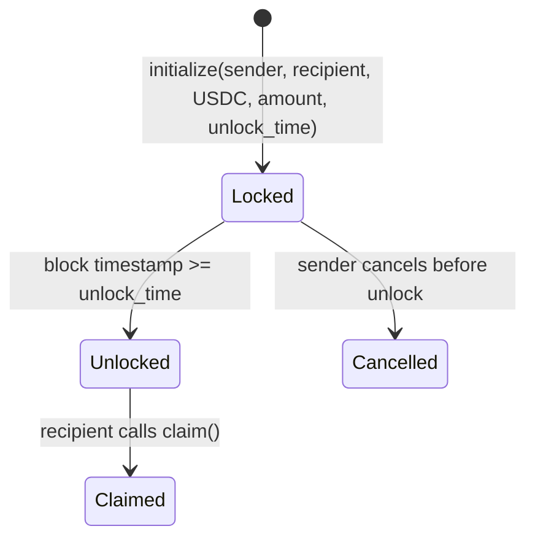

# Stellar & USDC Concepts Primer for Lumigift Contributors

> **Audience:** New contributors unfamiliar with Stellar.  
> **Goal:** Give you enough context to read, understand, and contribute to the
> blockchain-related parts of Lumigift without a prior Stellar background.

---

## Table of Contents

1. [Why Stellar?](#why-stellar)
2. [Stellar Accounts](#stellar-accounts)
3. [Trustlines](#trustlines)
4. [USDC (Stablecoin)](#usdc-stablecoin)
5. [Soroban Smart Contracts](#soroban-smart-contracts)
6. [How Lumigift Uses These Concepts](#how-lumigift-uses-these-concepts)
7. [Glossary](#glossary)
8. [Further Reading](#further-reading)

---

## Why Stellar?

Lumigift sends time-locked cash gifts. The blockchain layer must hold USDC in
escrow until a predetermined unlock date, then release it to the recipient.
Stellar was chosen over Ethereum/Solana/etc. for three reasons documented in
[ADR-0001](../adr/0001-blockchain-stellar-soroban.md):

- **Native USDC** — Circle issues USDC directly on Stellar, no bridge risk.
- **Near-zero fees** — ~0.00001 XLM per transaction, making ₦500 micro-gifts viable.
- **Soroban** — Smart contracts in Rust with deterministic WASM execution and
  time-based locking logic.

---

## Stellar Accounts

A Stellar account is the on-chain identity that can hold balances and submit
transactions. Every account has:

- A **public key** (starts with `G`, 56 characters) — share freely, used as a
  payment destination.
- A **secret key** (starts with `S`, 56 characters) — signs transactions. **Never
  expose this.**
- A **sequence number** — increments with each transaction to prevent replays.
- **Balances** — one per asset the account holds (XLM, USDC, etc.).

### Minimum Balance & Reserves

Stellar requires accounts to maintain a minimum XLM balance (base reserve,
currently 1 XLM) plus a small reserve for each trustline and offer. This means a
new account needs at least 1 XLM to exist on-chain.

### Lumigift's Server Account

Lumigift operates a **server escrow account** — a Stellar account controlled by
the backend that funds escrow contracts and disburses USDC to recipients on
claim. Its keys are loaded from environment variables:

```
src/server/config/index.ts → serverConfig.stellar.serverSecretKey
src/server/config/index.ts → serverConfig.stellar.serverPublicKey
```

The public key is derived from the secret in `src/lib/stellar.ts`:

```typescript
// src/lib/stellar.ts
export function getServerPublicKey(): string {
  const keypair = Keypair.fromSecret(serverConfig.stellar.serverSecretKey);
  return keypair.publicKey();
}
```

### Code References

| Concept                              | File                                                                                  |
| ------------------------------------ | ------------------------------------------------------------------------------------- |
| Server keypair derivation            | `src/lib/stellar.ts` → `getServerPublicKey()`                                         |
| Account loading (balances, sequence) | `src/lib/stellar.ts` → `loadAccount()`                                                |
| Server config (secret/public key)    | `src/server/config/index.ts` → `serverConfig.stellar`                                 |
| Env validation for keys              | `src/server/config/env.ts` → `STELLAR_SERVER_SECRET_KEY`, `STELLAR_SERVER_PUBLIC_KEY` |

---

## Trustlines

A **trustline** is an on-chain declaration that an account is willing to hold a
specific asset issued by a specific issuer. Before an account can receive or
hold USDC, it must establish a trustline to the USDC issuer.

### How It Works

1. The account submits a `ChangeTrust` operation specifying the asset
   (code + issuer).
2. Stellar deducts a small reserve (0.5 XLM) for the trustline.
3. The account can now receive and send that asset.

Without a trustline, a `payment` operation for that asset will fail.

### Lumigift Usage

Recipients must have a USDC trustline before they can claim a gift. Lumigift
provides a helper to establish one:

```typescript
// src/lib/stellar.ts
export async function establishUsdcTrustline(secretKey: string): Promise<string> {
  const keypair = Keypair.fromSecret(secretKey);
  const account = await getServer().loadAccount(keypair.publicKey());

  const tx = new TransactionBuilder(account, {
    fee: BASE_FEE,
    networkPassphrase: getNetworkPassphrase(),
  })
    .addOperation(Operation.changeTrust({ asset: getUSDC() }))
    .setTimeout(30)
    .build();

  tx.sign(keypair);
  const result = await getServer().submitTransaction(tx);
  return result.hash;
}
```

The USDC asset object is constructed from environment config:

```typescript
// src/lib/stellar.ts
function getUSDC(): Asset {
  if (!_USDC) {
    _USDC = new Asset(serverConfig.usdc.assetCode, serverConfig.usdc.issuer);
  }
  return _USDC;
}
```

### Code References

| Concept                   | File                                                          |
| ------------------------- | ------------------------------------------------------------- |
| Trustline establishment   | `src/lib/stellar.ts` → `establishUsdcTrustline()`             |
| USDC asset construction   | `src/lib/stellar.ts` → `getUSDC()`                            |
| USDC issuer / code config | `src/server/config/index.ts` → `serverConfig.usdc`            |
| Env validation for issuer | `src/server/config/env.ts` → `USDC_ISSUER`, `USDC_ASSET_CODE` |

---

## USDC (Stablecoin)

USDC is a USD-pegged stablecoin issued by Circle. On Stellar, USDC is a
**credit asset** — it is issued by a specific account (the issuer) and held via
trustlines. Each USDC token is backed 1:1 by USD reserves held by Circle.

### Key Properties for Lumigift

- **7 decimal places** — Stellar represents USDC amounts with 7 decimal places
  (e.g., `"10.0000000"`). This is why `Gift.amountUsdc` is stored as a string to
  preserve precision.
- **Issuer-guaranteed** — Unlike wrapped tokens on other chains, USDC on Stellar
  is natively issued by Circle. No bridge risk.
- **Low volatility** — Pegged to USD, so a ₦5,000 gift holds its value from
  creation to unlock.

### NGN → USDC Conversion

Lumigift accepts payment in NGN (via Paystack/Stripe) and converts to USDC at the
live exchange rate for on-chain escrow:

```typescript
// src/server/services/gift.service.ts
export async function ngnToUsdc(ngn: number): Promise<string> {
  const { ngnPerUsdc } = await getExchangeRate();
  return (ngn / ngnPerUsdc).toFixed(7);
}
```

The exchange rate is fetched from Stellar Horizon and cached in Redis for 60
seconds (`src/server/services/exchange-rate.service.ts`).

### USDC Payment on Claim

When a recipient claims a gift, Lumigift sends USDC from the server escrow
account to the recipient's Stellar address:

```typescript
// src/lib/stellar.ts
export async function sendUsdcPayment(
  destinationPublicKey: string,
  amount: string
): Promise<string> {
  // ... builds, signs, and submits a payment operation
  // amount is a decimal string like "10.0000000"
}
```

### Code References

| Concept                                | File                                                                 |
| -------------------------------------- | -------------------------------------------------------------------- |
| USDC balance lookup                    | `src/lib/stellar.ts` → `getUsdcBalance()`                            |
| USDC payment (claim disbursement)      | `src/lib/stellar.ts` → `sendUsdcPayment()`                           |
| NGN → USDC conversion                  | `src/server/services/gift.service.ts` → `ngnToUsdc()`                |
| Exchange rate service                  | `src/server/services/exchange-rate.service.ts` → `getExchangeRate()` |
| Gift amount storage (string precision) | `src/types/index.ts` → `Gift.amountUsdc`                             |

---

## Soroban Smart Contracts

Soroban is Stellar's smart contract platform. Contracts are written in Rust,
compiled to WebAssembly (WASM), and deployed as contract instances on the
Stellar network.

### Key Concepts

- **Contract ID** — A unique identifier (starts with `C`) for a deployed contract
  instance. Each gift gets its own escrow contract instance.
- **Functions** — Contracts expose functions callable via `contract.call()`.
  Lumigift's escrow contract exposes: `initialize`, `claim`, `get_state`,
  `get_status`, and `cancel`.
- **Simulation** — Read-only calls (like `get_state`) are simulated locally
  without submitting a transaction. Write calls are simulated first, then
  assembled into a transaction, signed, and submitted.
- **Types** — Soroban uses its own type system (ScVal). The SDK provides
  `nativeToScVal` / `scValToNative` for conversion between Rust/JS types.

### Lumigift's Escrow Contract

The escrow contract lives at `contracts/escrow/src/lib.rs` (Rust). The TypeScript
client is at `src/lib/contracts/escrow-client.ts`.

#### Contract Lifecycle



#### Initialize (Lock Funds)

When a gift is funded, Lumigift deploys and initializes an escrow contract:

```typescript
// src/lib/contracts/escrow-client.ts
async buildInitialize(
  sender: string,      // G... sender public key
  recipient: string,   // G... recipient public key
  token: string,       // C... USDC contract address
  amount: bigint,      // i128 amount in stroops
  unlockTime: bigint   // u64 Unix timestamp
): Promise<string>     // Returns signed XDR envelope
```

The contract verifies:

- The token is an allowed USDC contract (`EscrowError.InvalidToken` if not).
- The unlock time is in the future (`EscrowError.InvalidUnlockTime`).
- The amount is positive (`EscrowError.InvalidAmount`).

#### Claim (Release Funds)

When the recipient claims after unlock:

```typescript
// src/lib/contracts/escrow-client.ts
async buildClaim(): Promise<string>
```

The contract verifies:

- The caller is the designated recipient (`EscrowError.Unauthorized`).
- The unlock time has passed (`EscrowError.StillLocked`).
- The gift hasn't already been claimed (`EscrowError.AlreadyClaimed`).

#### State Inspection

Two read-only methods allow the backend to verify on-chain state:

```typescript
// Returns full state: recipient, amount, unlockTime, claimed
async getState(): Promise<EscrowState>

// Returns lifecycle status enum: Locked | Unlocked | Claimed | Cancelled
async getStatus(): Promise<EscrowStatus>
```

### Error Handling

The client maps Soroban error codes to a typed `EscrowContractError`:

```typescript
// src/lib/contracts/escrow-client.ts
export enum EscrowError {
  AlreadyInitialized = 1,
  AlreadyClaimed = 2,
  StillLocked = 3,
  NotInitialized = 4,
  Unauthorized = 5,
  AlreadyCancelled = 6,
  InvalidAmount = 7,
  InvalidUnlockTime = 8,
  InvalidToken = 9,
}
```

### Code References

| Concept                    | File                                                          |
| -------------------------- | ------------------------------------------------------------- |
| Escrow contract (Rust)     | `contracts/escrow/src/lib.rs`                                 |
| TypeScript client          | `src/lib/contracts/escrow-client.ts`                          |
| Contract events schema     | `src/lib/contracts/escrow-events.ts`                          |
| Client factory (env-based) | `src/lib/contracts/escrow-client.ts` → `createEscrowClient()` |
| Gift lifecycle doc         | `docs/architecture/gift-lifecycle.md`                         |
| Blockchain ADR             | `docs/adr/0001-blockchain-stellar-soroban.md`                 |

---

## How Lumigift Uses These Concepts

### End-to-End Gift Flow

1. **Gift Creation** — Sender creates a gift with NGN amount and unlock date.
   The NGN→USDC conversion is computed at the live rate (`gift.service.ts` →
   `ngnToUsdc()`).

2. **Payment** — Sender pays in NGN via Paystack. The gift enters
   `pending_payment` status.

3. **Funding** — Paystack webhook confirms payment. Gift status → `funded`.

4. **Escrow Lock** — Lumigift deploys a Soroban escrow contract via
   `EscrowClient.buildInitialize()` and transfers USDC to it. Gift status →
   `locked`. The `contractId` and `stellarTxHash` are stored on the gift record.

5. **Unlock** — A daily cron job (`/api/v1/cron/unlock`) finds gifts past their
   unlock date and transitions them to `unlocked`.

6. **Claim** — Recipient provides their Stellar public key. Lumigift verifies
   on-chain state via `EscrowClient.getState()`, sends USDC via
   `sendUsdcPayment()`, and transitions the gift to `claimed`.

7. **Expiry** — Unclaimed gifts expire after 365 days; funds are refunded to the
   sender's Stellar address.

### Where Each Concept Appears

| Stellar Concept     | Lumigift Component      | Key File(s)                                                                          |
| ------------------- | ----------------------- | ------------------------------------------------------------------------------------ |
| Account (server)    | Server escrow account   | `src/lib/stellar.ts`, `src/server/config/index.ts`                                   |
| Account (recipient) | Claim flow              | `src/server/services/claim.service.ts`                                               |
| Trustline           | Pre-claim setup         | `src/lib/stellar.ts` → `establishUsdcTrustline()`                                    |
| USDC                | Gift value storage      | `src/types/index.ts` → `Gift.amountUsdc`                                             |
| USDC payment        | Claim disbursement      | `src/lib/stellar.ts` → `sendUsdcPayment()`                                           |
| Exchange rate       | NGN→USDC conversion     | `src/server/services/exchange-rate.service.ts`                                       |
| Soroban contract    | Escrow locking          | `src/lib/contracts/escrow-client.ts`, `contracts/escrow/src/lib.rs`                  |
| Contract events     | Event indexing          | `src/lib/contracts/escrow-events.ts`, `src/server/services/event-indexer.service.ts` |
| Horizon API         | Account/balance queries | `src/lib/stellar.ts` → `loadAccount()`, `getUsdcBalance()`                           |

### Configuration

All Stellar-related configuration is centralized in `src/server/config/index.ts`
and validated by Zod schemas in `src/server/config/env.ts`:

| Env Variable                 | Purpose                             |
| ---------------------------- | ----------------------------------- |
| `STELLAR_NETWORK`            | `testnet` or `mainnet`              |
| `STELLAR_HORIZON_URL`        | Horizon API endpoint                |
| `STELLAR_RPC_URL`            | Soroban RPC endpoint                |
| `STELLAR_NETWORK_PASSPHRASE` | Network passphrase (Public/Testnet) |
| `STELLAR_ESCROW_CONTRACT_ID` | Deployed escrow contract ID (C…)    |
| `STELLAR_SERVER_SECRET_KEY`  | Server account secret key (S…)      |
| `STELLAR_SERVER_PUBLIC_KEY`  | Server account public key (G…)      |
| `USDC_ISSUER`                | USDC issuer public key (G…)         |
| `USDC_ASSET_CODE`            | Asset code (default: `USDC`)        |

---

## Glossary

| Term                | Definition                                                                                            |
| ------------------- | ----------------------------------------------------------------------------------------------------- |
| **Account**         | On-chain identity with a keypair (G…/S…) that can hold balances and submit transactions.              |
| **Asset**           | A unit of value on Stellar. XLM is native; everything else is a credit asset (code + issuer).         |
| **ChangeTrust**     | Operation that establishes a trustline, allowing an account to hold a credit asset.                   |
| **Contract ID**     | Unique identifier (C…) for a deployed Soroban contract instance.                                      |
| **Escrow**          | A contractual arrangement where a third party holds funds until conditions are met.                   |
| **Horizon**         | Stellar's REST API server for querying accounts, transactions, and submitting to the network.         |
| **Issuer**          | The Stellar account that created a credit asset. For USDC, this is Circle's account.                  |
| **Keypair**         | A public/secret key pair. Public key (G…) identifies the account; secret key (S…) signs transactions. |
| **Payment**         | Operation that transfers an asset from one account to another.                                        |
| **Reserve**         | Minimum XLM balance required to keep an account or trustline on-chain.                                |
| **ScVal**           | Soroban's native value type used for contract argument encoding/decoding.                             |
| **Sequence Number** | Per-account counter incremented with each transaction to prevent replays.                             |
| **Soroban**         | Stellar's smart contract platform. Contracts are written in Rust and compiled to WASM.                |
| **Stroop**          | The smallest unit of an asset on Stellar (1 unit = 10⁻⁷). USDC amounts use 7 decimal places.          |
| **Trustline**       | An account's declaration that it accepts a specific credit asset from a specific issuer.              |
| **XDR**             | External Data Representation — binary format for encoding Stellar transactions.                       |
| **XLM**             | Stellar's native cryptocurrency. Used for transaction fees and minimum reserves.                      |

---

## Further Reading

### Official Stellar Documentation

- [Stellar Docs — Get Started](https://developers.stellar.org/docs/get-started)
- [Stellar Accounts](https://developers.stellar.org/docs/learn/fundamentals/accounts)
- [Trustlines & Assets](https://developers.stellar.org/docs/learn/fundamentals/anchors-and-assets)
- [Stellar Transactions](https://developers.stellar.org/docs/learn/fundamentals/transactions)
- [Stellar Fees & Reserves](https://developers.stellar.org/docs/learn/fundamentals/fees-and-reserves)

### USDC on Stellar

- [Circle USDC on Stellar](https://developers.stellar.org/docs/learn/fundamentals/stablecoins/usdc)
- [USDC Issuer Addresses](https://circle.com/en/multi-chain-usdc)

### Soroban (Smart Contracts)

- [Soroban Documentation](https://developers.stellar.org/docs/build/smart-contracts)
- [Soroban Rust SDK](https://docs.rs/soroban-sdk/latest/soroban_sdk/)
- [Contract Deployment Guide](https://developers.stellar.org/docs/build/smart-contracts/deploy)
- [Soroban RPC API](https://developers.stellar.org/docs/data/rpc)

### JavaScript SDK

- [Stellar JS SDK (js-stellar-sdk)](https://developers.stellar.org/docs/build/guides/js-sdk)
- [Stellar JS SDK API Reference](https://stellar.github.io/js-stellar-sdk/)

### Lumigift-Specific

- [ADR-0001: Blockchain Platform Decision](../adr/0001-blockchain-stellar-soroban.md)
- [Gift Lifecycle: States & Blockchain Interactions](./gift-lifecycle.md)
- [Escrow Contract Source](../../contracts/escrow/src/lib.rs)
- [Escrow Client (TypeScript)](../../src/lib/contracts/escrow-client.ts)
- [Stellar Helpers](../../src/lib/stellar.ts)
- [Server Configuration](../../src/server/config/index.ts)
